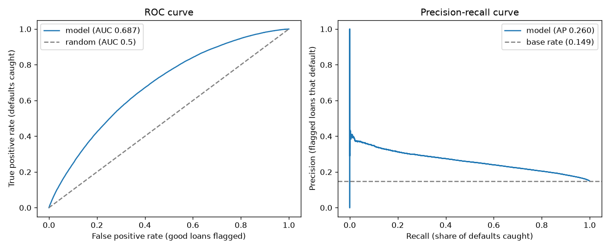
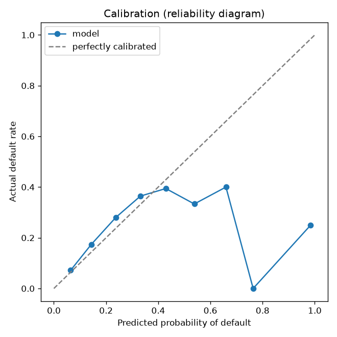
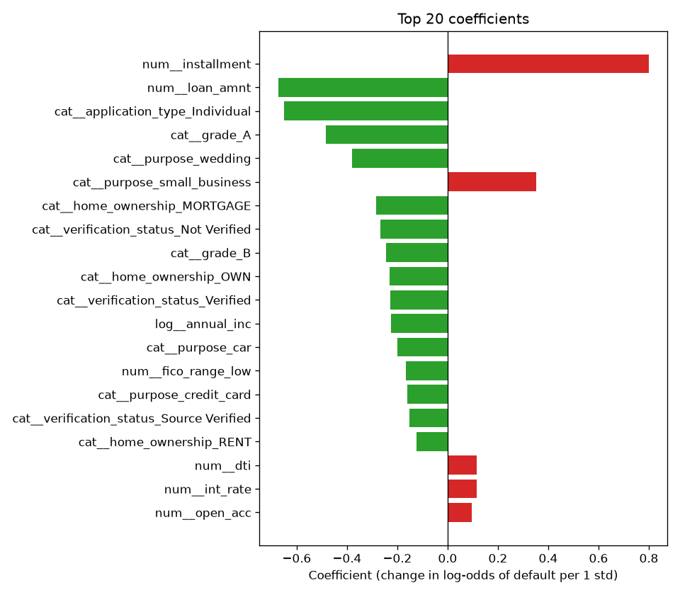

# Project 1 - Logistic Regression: Will This Loan Default?

**Course section:** 30 (Logistic Regression)
**Dataset:** Lending Club, all accepted loans 2007–2018. That's 2.26 million real US peer-to-peer loans with the
real outcome of each one ([Kaggle: wordsforthewise/lending-club](https://www.kaggle.com/datasets/wordsforthewise/lending-club), CC0 licence).
**The question:** on the day someone applies, how likely are they to stop paying back their loan?

All the code is in [logistic_regression.py](logistic_regression.py), with a comment on every line. It has 6 steps, each with tests.
This README explains every concept you need, in the order you meet it.

---

## How to work

```powershell
cd "D:\AI Projects\ML_Mini_Projects\01_logistic_regression"
..\.venv\Scripts\python -m pytest -q -k step1      # run only the step-1 tests
```

1. Open `logistic_regression.py` and find the first `TODO`.
2. The comments under it are hints, in order. Turn each hint into code.
3. **Comment every line you write** with *why* it is there, not just *what* it does.
   - Bad: `# divide by n`
   - Good: `# average over all loans so the gradient doesn't grow with dataset size`
4. Run the step's tests. Red means read the failing test: it says exactly what was expected.
5. When a step is green, show me the code. I'll review it like a senior engineer, then you move on.
6. Stuck for more than 20 minutes? Ask for a **hint**, not the answer. You learn far more from writing it
   yourself.

When all 6 steps pass, run the real thing on all 2.26M loans (about 2 minutes):
```powershell
..\.venv\Scripts\python logistic_regression.py            # full data
..\.venv\Scripts\python logistic_regression.py --sample   # quick run on the 20k sample
```

| Step | You build | Tests |
|---|---|---|
| 1 | load the data, build the target | `-k step1` |
| 2 | clean two messy columns, split by time | `-k step2` |
| 3 | a preprocessing pipeline (impute, log, scale, one-hot) | `-k step3` |
| 4 | **logistic regression from scratch in NumPy**, matching scikit-learn | `-k step4` |
| 5 | the real model, honest metrics, a cost-based threshold | `-k step5` |
| 6 | plots, and the "break it" experiment (data leakage) | `-k step6` |
| 7 | tuning honestly: ratio features, splines, `C` chosen on a validation year | `-k step7` |

---

## The concepts, explained

### 1. The problem: binary classification
Each loan ends in one of two ways: **Fully Paid** (0) or **Charged Off**, meaning the lender gave up on getting
it back (1). Predicting one of two outcomes is **binary classification**. We want more than a yes/no answer: we
want a **probability**, such as "this loan has a 23% chance of defaulting". A bank prices and approves loans
from that number.

### 2. Why we only use *finished* 36-month loans from 2012–2015 (survivorship bias)
About 880,000 loans in the file are still "Current", so their outcome is unknown and we can't learn from them.
Simply dropping them creates a trap:

- Among loans issued in 2016, the *finished* ones are mostly those that ended early.
- Loans end early mainly by **defaulting**, since most good loans are still being paid.
- So 2016's finished loans show a fake 19.8% default rate, against about 14% in earlier years.

This is **survivorship bias**: the rows you can see are not a fair sample of all rows.

The fix: use only 36-month loans issued 2012–2015. All of them had reached their end date by 2018, so every
outcome is known.

### 3. The target and class imbalance
About **14%** of these loans default. When one class is much rarer, the data is **imbalanced**. A useless model
that says "nobody defaults" is already 86% *accurate*, which is why **accuracy is the wrong metric here** (see
section 10).

### 4. Splitting by time, not at random
Real life: a bank trains on past loans and uses the model on *future* applicants. So we train on 2012–2014 and
test on 2015.

A random split would let the model learn from 2015 loans while being tested on other 2015 loans. It would see
"the future" (the 2015 economy, 2015 lending rules), and its score would be better than it will ever be in real
use. This is called **temporal leakage**.

### 5. Features and data leakage
A **feature** is an input the model uses, for example income or FICO credit score. The golden rule: **only use
what is known on the day of the application.**

- `total_pymnt` (how much was repaid) and `recoveries` (money collected after default) are only known *after*
  the loan ends.
- `last_fico_range_high` is the borrower's *latest* credit score, often taken after they stopped paying.

Using any of them is **data leakage**: the model gets the answer hidden in its input. It scores brilliantly in
testing and is useless in production, because those columns don't exist yet when someone applies. In step 6
you do this on purpose and watch AUC jump from about 0.69 to about 0.99.

A subtle case to think about: `int_rate` and `grade` *are* known at application time. But Lending Club set them
using its *own* risk model, so our model partly learns Lending Club's opinion. That's legitimate, but worth
saying in an interview.

### 6. Cleaning messy columns
Real data comes as text: `emp_length` is `"10+ years"`, `"< 1 year"` or `"3 years"`; `earliest_cr_line` is
`"Aug-2003"`. Models need numbers, so you convert them. Text like this is turned into numbers with a **regular
expression**: `\d+` means "one or more digits".

### 7. The preprocessing pipeline
Four transformations, each for a reason:

- **Imputation** fills in missing values, for example 6.5% of `emp_length` is blank. We use the **median** of
  the training data for numbers, because one billionaire can't drag the median around the way they drag the
  mean. For text columns we use the most frequent value.
- **Log transform**, `log(1 + x)`: incomes range from $4k to $9M. The log squashes that range, so a few huge
  values don't dominate. We use the "1 +" so that `x = 0` still works.
- **Standardisation**, `(x - mean) / std`: every feature gets mean 0 and spread 1. Gradient descent then moves
  at a similar speed in every direction. Regularisation (section 9) then also treats all features fairly, and
  coefficients become comparable with each other.
- **One-hot encoding**: `purpose = "car"` becomes a column `purpose_car = 1` (0 for every other purpose). This
  avoids inventing a fake order such as "car = 1 < house = 2".

**Why a `Pipeline`:** `.fit()` learns the medians, means and categories from the **training data only**.
`.transform()` re-uses them on the test data. If you computed the mean on all the data first, test information
would leak into training. A pipeline makes that mistake impossible.

### 8. Logistic regression itself
1. Compute a **linear score**: `z = w1*x1 + w2*x2 + ... + b`. Each weight `w` says how much a feature pushes
   towards default.
2. Squash it into a probability with the **sigmoid**: `p = 1 / (1 + e^-z)`. Large `z` gives p close to 1, `z = 0`
   gives p = 0.5, and very negative `z` gives p close to 0.
3. **Interpretation:** `z` is the **log-odds**, `log(p / (1 - p))`. Raising feature *j* by one unit (one standard
   deviation here, because we scaled) multiplies the odds of default by `e^wj`.

**Numerical stability:** `e^-z` for `z = -1000` is `e^1000`, which overflows. The step-4 trick computes the same
value in a rearranged form for negative `z`, so it never overflows. Real libraries all do this.

### 9. Training: log loss, gradient descent and regularisation
- **Log loss (binary cross-entropy):** `-mean(y*log(p) + (1-y)*log(1-p))`. It punishes confident mistakes
  hard: saying p = 0.01 for a loan that defaults costs `-log(0.01) = 4.6`, while p = 0.5 costs only 0.69.
- **The gradient:** the calculus works out to `dLoss/dz = p - y` ("prediction minus truth"). That gives
  `grad_w = Xᵀ(p - y)/n`. In step 4 you check your gradient against a numerical estimate (**finite
  differences**). This is how researchers catch bugs in gradients.
- **Gradient descent:** repeat `w = w - learning_rate * grad_w`. Each step moves downhill on the loss. Log loss
  for logistic regression is **convex** (bowl-shaped), so there is exactly one bottom, and you reach the same
  answer as scikit-learn.
- **Regularisation** adds a penalty for large weights:
  - **L2:** `(λ/2)·Σw²` shrinks all weights a bit, which reduces overfitting.
  - **L1:** `λ·Σ|w|` pushes useless weights to exactly zero, so it also selects features.
- **scikit-learn's `C`** is the *inverse* strength: `C = 1/(λ·n)`. A small C means a strong penalty and a
  simpler model.

### 10. Evaluating honestly
| Metric | What it answers | Here |
|---|---|---|
| **ROC-AUC** | If I pick one defaulter and one good borrower at random, how often does the model rank the defaulter riskier? 0.5 = coin flip, 1.0 = perfect | about 0.69: credit risk is genuinely hard; 0.70 is respectable |
| **PR-AUC** (average precision) | Of the loans I flag, how many really default, across all thresholds? | compare it to the **base rate** (about 0.14), not to 0.5 |
| **Brier score** | Mean squared error of the probabilities | lower is better |
| **Log loss** | The training objective, measured on the test set | lower is better |
| **Calibration** | When the model says 20%, do about 20% of those loans really default? | step-6 plot |

**ROC vs PR:** with rare defaults, ROC can look rosy because it counts correct "no" answers on the many good
loans. PR focuses on the rare class. Report both.

### 11. Class weights and calibration
`class_weight="balanced"` makes each default count about 6 times more in the loss. The model then flags more
defaults, but its **probabilities become inflated**: an average prediction of about 45% when the truth is about
14%. A bank pricing loans needs *honest* probabilities. Usually it's better to keep the plain model and move the
**threshold** instead (section 12). The step-5 test proves the inflation.

### 12. Choosing a threshold with business costs
A probability becomes a decision ("reject if p ≥ t") through a **threshold**. The default 0.5 is arbitrary.

Ask what each mistake costs. A missed default (a **false negative**) loses most of the loan. A rejected good
borrower (a **false positive**) loses only the interest you would have earned. If a miss costs 5 times more,
the best threshold is much lower than 0.5. In step 5 you find it by trying every threshold and adding up the
cost.

### 13. Reading the coefficients
After scaling, a coefficient of +0.3 on `int_rate` means "one standard deviation higher interest rate raises the
log-odds of default by 0.3". Positive means riskier, negative means safer. The step-6 bar chart shows the top
20. Check whether they make business sense: a higher FICO score should be negative and a higher debt-to-income
ratio should be positive. Use them with care when features are correlated (`int_rate` and `grade` carry almost
the same information).

---

## Results (full data: 306,462 training loans from 2012–14, 283,026 test loans from 2015)

| | Plain model | `class_weight="balanced"` |
|---|---|---|
| ROC-AUC | **0.687** | 0.687 |
| PR-AUC (base rate 0.149) | **0.261** (1.75× the base rate) | 0.260 |
| Brier score | **0.120** | 0.216 |
| Log loss | **0.395** | 0.621 |
| Average predicted default rate (true: 14.9%) | 12.7% | **45.1%** |
| Best threshold if a missed default costs 5× a false alarm | 0.14 | 0.52 |

**Data leakage ("break it"):** adding three columns known only after the loan ends lifts ROC-AUC from **0.687
to 0.995**. The leaky model is impressive and useless: those columns don't exist on the day someone applies.



### What the results show

1. **Credit risk is hard, and 0.69 AUC is honest.** The model ranks a random defaulter above a random good
   borrower 69% of the time. Published results on this dataset with application-time features are typically
   0.68–0.72. Anything near 0.95 almost always means leakage, as step 6 shows.

2. **The 0.5 threshold is useless here.** Almost no loan reaches a predicted probability of 0.5, so at 0.5 the
   model flags essentially nothing. With a cost-based threshold of **0.14**, it flags 36.7% of loans and catches
   **59.3% of all defaults**. 24.1% of the flagged loans really default, against 14.9% if you picked at random.
   The threshold is a business decision, not a property of the model.

3. **`class_weight="balanced"` changed the probabilities, not the ranking.** AUC is identical, but the average
   predicted risk jumped from 12.7% to 45.1% (the truth is 14.9%), and Brier and log loss got much worse. The
   best threshold simply moved from 0.14 to 0.52. A bank pricing loans needs honest probabilities, so keep the
   plain model and move the threshold.

4. **The world changed between 2014 and 2015 (concept drift).** The model predicts 12.7% defaults; the real rate
   was 14.9%. The calibration plot shows it slightly *under*-predicting in every bin up to 0.4. By grade, it
   under-predicts more as risk rises: grade E is predicted 26% and was really 33%. A model trained on the past
   needs monitoring and regular recalibration. A random split would have hidden this completely.

   

   The wild points above 0.4 on the calibration plot are **noise, not signal**. Only 463 of 283,026 loans have
   p > 0.4, and only 11 have p > 0.6. Always check how many points sit behind a dot.

5. **Coefficients lie when features are correlated (multicollinearity).** The biggest coefficients are
   `installment` (+0.80) and `loan_amnt` (−0.68). Read naively, "bigger loans are *safer*", which is nonsense.
   The two columns are 0.995 correlated (the installment is basically the loan amount divided over 36 months),
   so the model splits their effect into two large, opposite-signed numbers that mostly cancel. What the pair
   really says: *for the same loan amount, a higher monthly payment (i.e. a higher interest rate) means more
   risk*. Similarly, `int_rate` looks weak (+0.11) only because the `grade` columns already carry the same
   information. To interpret coefficients, drop one of a correlated pair, or use L1 regularisation. To
   *predict*, it doesn't matter.

   

6. **The from-scratch version matches scikit-learn.** Gradient descent on the regularised log loss reaches the
   same weights as scikit-learn to 3 decimal places (step-4 test). The gradient was verified against finite
   differences.

### Step 7: can tuning push ROC-AUC up?

**Rule:** tuning decisions are made on a **validation year**. We fit on 2012–13 and score on 2014. The 2015
test set is looked at **once**, at the very end. Picking `C` by peeking at 2015 would make the test score a lie,
because you'd have tuned to that particular year's noise.

| What was tried (validation AUC, 2014) | AUC | Gain |
|---|---|---|
| Baseline, `C=1` | 0.6703 | |
| Tune `C` only (best: 0.001) | 0.6722 | +0.002 |
| L1 instead of L2 | 0.6710 | +0.001, and 6 minutes to fit instead of 5 seconds |
| + affordability ratios (loan/income, payment/income, card debt/income) | 0.6720 | +0.002 |
| + `sub_grade` (A1…G5) and state | 0.6733 | +0.003 |
| + **splines** on every number, so each feature can bend into a curve | 0.6753 | +0.005 |
| All of the above with `C` re-tuned (best: 0.003) | **0.6759** | +0.006 |
| *For comparison:* gradient boosting (`HistGradientBoostingClassifier`) on the same features | 0.6757 | +0.005 |

**Final, test year 2015 (one look): ROC-AUC 0.687 → 0.692, PR-AUC 0.261 → 0.264.**

What this teaches:
- **Hyperparameter tuning was the smallest lever.** `C` barely matters with 300k rows, because there is so much
  data that regularisation has little to fix. Features and model shape mattered more.
- **Splines are how a linear model learns curves.** A spline turns one number into several smooth "bump"
  columns, so risk can, for example, rise steeply at low FICO scores and flatten at high ones. The model is
  still logistic regression, just on curved inputs.
- **The ceiling is the data, not the algorithm.** Gradient boosting, a far more flexible model, landed at the
  *same* validation AUC. When strong and simple models agree, the features hold no more signal. Going higher
  needs **new information**, not more tuning.
- **+0.005 AUC still matters at scale.** Across 283k loans a year, a small ranking gain moves real money. In a
  report, state it as it is: a small, honest gain.

### What I'd do next
- New information beats tuning: credit-bureau history, bank-transaction data, or the free-text `emp_title`
  and loan description turned into features (NLP, in a later track).
- Recalibrate on the most recent year (Platt scaling or isotonic regression) to fix the drift.
- Compare with the tree models in Projects 5–9, which find interactions automatically.

## Interview questions this project prepares you for
1. Why is accuracy misleading for loan default? What do you use instead?
2. What is data leakage? Give two examples from this dataset.
3. Why split by time instead of at random?
4. Derive the gradient of log loss for logistic regression.
5. What does `C` do in scikit-learn's `LogisticRegression`? L1 vs L2?
6. What does `class_weight="balanced"` do to predicted probabilities, and when is that a problem?
7. How would you choose a decision threshold for approving loans?
