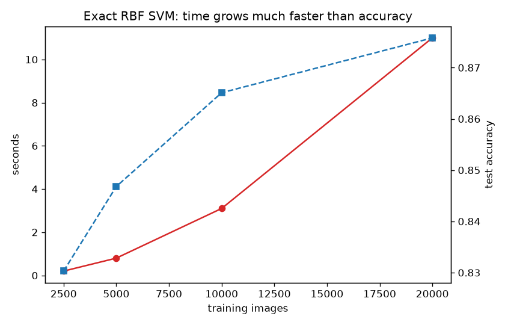
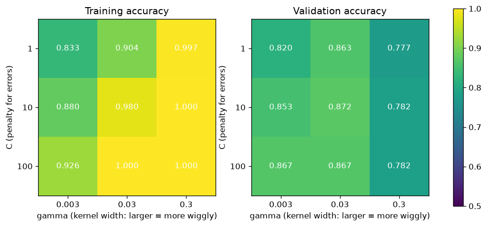
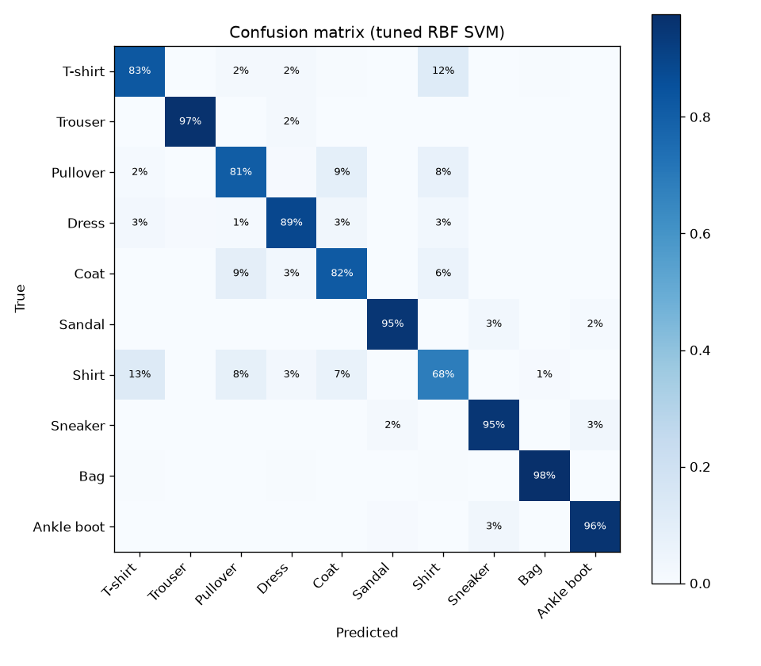

# Project 2 - Support Vector Machines: Classifying 70,000 Clothing Images

**Course section:** 31 (Support Vector Machines)
**Dataset:** [Fashion-MNIST](https://github.com/zalandoresearch/fashion-mnist) by Zalando Research: 70,000
greyscale 28×28 photos of 10 kinds of clothing. It was created as a harder replacement for handwritten digits
(MIT licence).
**The question:** how good can an SVM get on real images, and what does it cost?

All the code is in [svm.py](svm.py), with a comment on every line. Tests: [test_svm.py](test_svm.py).

```powershell
cd "D:\AI Projects\ML_Mini_Projects\02_svm"
..\.venv\Scripts\python -m pytest -q        # 5 tests, about 15 s
..\.venv\Scripts\python svm.py --quick      # sample run, about 30 s
..\.venv\Scripts\python svm.py              # full run, about 20 min (most of it is the Nyström experiment)
```
The full data downloads automatically through `sklearn.datasets.fetch_openml("Fashion-MNIST")`. The repo
holds a 4,000-image sample in `data/`.

---

## The concepts, explained

### 1. The idea: the widest street
A linear classifier draws a line (in many dimensions, a **hyperplane**) between two classes. Many lines
separate the training data; an SVM picks the one with the **widest margin**, the widest empty "street" between
the classes. A wide street means small changes to an image don't flip the answer, so the model generalises
better.

### 2. Support vectors
Only the points **on or inside the street's edges** decide where it goes. Those are the **support vectors**.
Delete any other training point and the answer doesn't change. That's why the trained model only stores the
support vectors: 6,848 of 20,000 images here.

### 3. Soft margin and `C`
Real classes overlap (a shirt can look like a T-shirt), so some points must be allowed inside the street or on
the wrong side. **`C`** sets the price of each violation:
- **Small C:** cheap violations, a wide street, a simpler model (it may underfit).
- **Large C:** expensive violations, the street bends around every point (it may overfit).

### 4. Hinge loss: the maths behind it
The SVM minimises `λ/2·‖w‖² + mean(max(0, 1 − y·(w·x + b)))`, with labels y ∈ {−1, +1}:
- `‖w‖²` small means a wide margin (the margin width is `2/‖w‖`);
- the **hinge** `max(0, 1 − y·score)` costs nothing for points safely past the margin, and grows linearly for
  violators.

The hinge has a kink at 1, so instead of a gradient we use a **subgradient**: only violating points push on
`w`. That's what `fit_linear_svm` does from scratch, with a step size that shrinks over time. It reaches
scikit-learn's exact optimum to within 1% (test). λ and scikit-learn's `C` are linked by `C = 1/(λ·n)`.

### 5. The kernel trick
Some classes can't be separated by a straight line. The fix: map each point into a richer space where a line
*does* work. The trick is that the SVM only ever needs **similarities between pairs of points** (dot
products), so we can replace the dot product with a **kernel** that computes the similarity in that richer
space directly, without building it.

The **RBF (Gaussian) kernel** is `k(x, z) = exp(−γ·‖x − z‖²)`, meaning "how close are these two images?".

### 6. `gamma`: how far one example's influence reaches
- **Small γ:** every training image influences a wide neighbourhood, giving smooth, simple boundaries.
- **Large γ:** each image only influences itself, so the model memorises the training set. You can see this in
  the grid below: at γ = 0.3 training accuracy is 100% while validation drops to 78%.

`C` and `γ` interact, so you tune them **together on a grid**, on validation data.

### 7. Multi-class
SVMs are binary. For 10 classes, `SVC` trains **one-vs-one**, one SVM per pair of classes (45 SVMs), and
takes a vote. `LinearSVC` trains **one-vs-rest**, 10 SVMs of "this class vs everything else".

### 8. Why SVMs don't scale, and PCA
An exact kernel SVM compares training points with each other, so its cost grows roughly with **n² to n³**. We
make it affordable in two ways:
- **PCA** compresses each 784-pixel image into 50 numbers that keep most of the information. Each kernel
  computation becomes about 16× cheaper.
- We train on 30,000 of the 60,000 images and *measure* the price of more (section on scaling below).

**Kernel approximation (Nyström)** approximates the RBF kernel with 3,000 explicit features, then runs a fast
*linear* SVM. In theory that scales linearly; see the results for what happened in practice.

### 9. Scaling inputs
SVMs measure distances, so every feature must be on a comparable scale. Pixels are divided by 255 into [0, 1].

---

## Results (train: 60,000 images, test: the official 10,000)

| Model | Test accuracy | Training time |
|---|---|---|
| Linear SVM, raw pixels, all 60k images | 84.0% | 98 s |
| **RBF SVM, PCA-50, tuned (C=10, γ=0.03), 30k images** | **88.3%** | **35 s** |
| Nyström (3,000 features) + linear SVM, all 60k images | 88.0% | 908 s |

### How an exact RBF SVM scales (C=10, PCA-50)

| Training images | Seconds | Accuracy | Support vectors |
|---|---|---|---|
| 2,500 | 0.2 | 83.0% | 1,282 |
| 5,000 | 0.8 | 84.7% | 2,186 |
| 10,000 | 3.1 | 86.5% | 3,874 |
| 20,000 | 11.0 | 87.6% | 6,848 |



### Tuning C and γ (fit on 8k images, validate on 4k)

| | γ=0.003 | γ=0.03 | γ=0.3 |
|---|---|---|---|
| C=1 | 82.0% (train 83.3%) | 86.3% (train 90.4%) | 77.7% (train **99.7%**) |
| C=10 | 85.3% (train 88.0%) | **87.2%** (train 98.0%) | 78.2% (train **100%**) |
| C=100 | 86.7% (train 92.6%) | 86.7% (train 99.99%) | 78.2% (train **100%**) |





### What the results show
1. **The kernel trick earns its keep:** 84.0% linear vs 88.3% RBF. Clothing classes aren't separable by
   straight lines in pixel space.
2. **Overfitting, visible:** with γ = 0.3 every model scores 100% on training images and only 78% on new ones.
   That's memorisation. The best cell (C=10, γ=0.03) still shows a gap (98% vs 87%), which is normal for a
   flexible model.
3. **The cost of scale is real:** 8× more training data took 55× longer, for +4.6 points of accuracy. The
   number of support vectors grows with the data too, so *prediction* also slows down. This is why SVMs lost
   ground to boosted trees and neural networks on big datasets.
4. **Kernel approximation didn't pay off here.** Nyström trained on twice as much data and matched the exact
   SVM (88.0% vs 88.3%), but took 26× longer. A 3,000-dimensional dense matrix × 60,000 rows × 10 one-vs-rest
   problems is a lot of work too. Approximations pay off at *much* larger n, or with SGD-based linear solvers.
   Measure, don't assume.
5. **The errors make sense:** Shirt is the hardest class (68% correct), confused with T-shirt (13%), Pullover
   (8%) and Coat (7%). Bags (98%) and trousers (97%) are easy. At 28×28 pixels many shirts and T-shirts are
   genuinely ambiguous even to people.

For context: published SVM results on Fashion-MNIST are about 89–90%, and CNNs reach about 93–95% (see the DL
mini projects).

## Interview questions this project prepares you for
1. What is a support vector, and why does the model only need those points?
2. What do `C` and `gamma` control? What happens when each is too large?
3. Explain the kernel trick without equations.
4. Why don't kernel SVMs scale to millions of rows? What would you use instead?
5. Why must inputs be scaled for an SVM but not for a decision tree?
