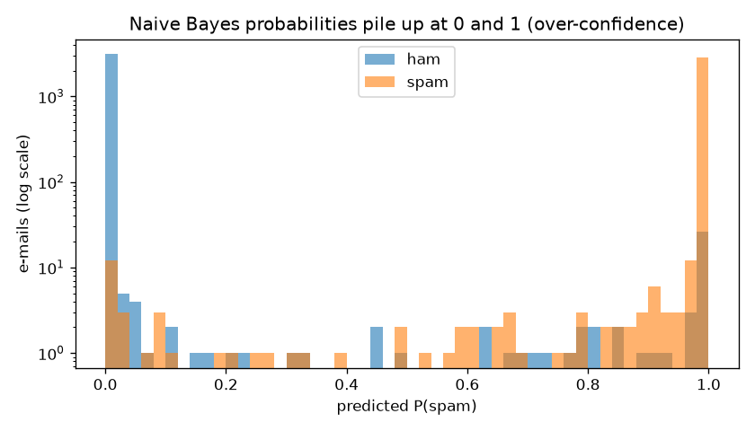
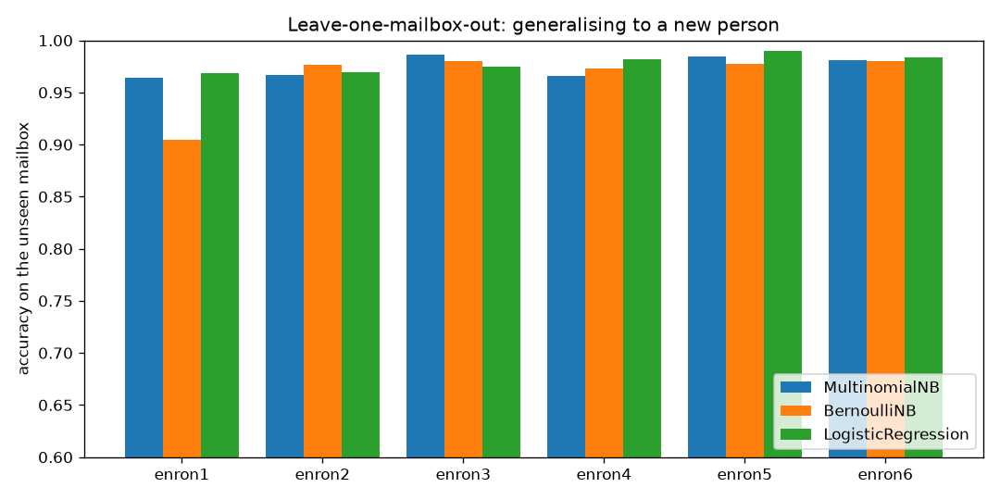

# Project 3 - Naive Bayes: Spam Filtering on the Enron-Spam Corpus

**Course section:** 32 (Naive Bayes)
**Dataset:** Enron-Spam (Metsis, Androutsopoulos & Paliouras, 2006, *"Spam Filtering with Naive Bayes – Which
Naive Bayes?"*). Six real Enron employees' mailboxes, each mixed with real spam: 33,716 e-mails, and 30,463
after removing exact duplicates.
**The question:** can the simplest probabilistic model filter spam, and does it still work on a *new person's*
inbox?

All the code is in [naive_bayes.py](naive_bayes.py), with a comment on every line. The data is built by
[build_dataset.py](build_dataset.py). Tests: [test_naive_bayes.py](test_naive_bayes.py).

```powershell
cd "D:\AI Projects\ML_Mini_Projects\03_naive_bayes"
..\.venv\Scripts\python build_dataset.py    # once: downloads the original archives (17 MB), builds the CSV
..\.venv\Scripts\python -m pytest -q        # 4 tests
..\.venv\Scripts\python naive_bayes.py      # full run, about 2 minutes
```

---

## First lesson: the popular Kaggle version of this dataset is broken

The first attempt used the most popular Kaggle CSV of Enron-Spam (`marcelwiechmann/enron-spam-data`, 5,000+
downloads). A plain Naive Bayes scored **99.2%**, which looked great.

Then the "most spam-like words" came out as `antonella`, `hsbcib` and `costas`, which are people's names, not
spam. Following that thread:
- the same genuine Enron e-mail ("fw : memo : re : your work phone number") appears **1,497 times, labelled
  spam**;
- after removing exact duplicates, **zero spam e-mails were left**. Every one of the 17,171 "spam" rows held
  the text of a *legitimate* e-mail.

The CSV seems to have been built with a bug that kept the spam row count but pasted ham text into it. The model
had been "detecting" a handful of duplicated business e-mails. **The fix:** rebuild the data from the authors'
original archives ([build_dataset.py](build_dataset.py)). The per-mailbox counts match the Kaggle file exactly;
only the text differs.

**The lesson:** a great score is a reason to look harder, not to celebrate. The thing that caught it was
*reading what the model relied on*.

---

## The concepts, explained

### 1. Bayes' theorem
`P(spam | words) = P(words | spam) · P(spam) / P(words)`

- **Prior** `P(spam)`: how common spam is before reading the e-mail.
- **Likelihood** `P(words | spam)`: how typical these words are of spam.
- **Posterior** `P(spam | words)`: what we want.

`P(words)` is the same for both classes, so we just compare `P(words | class) · P(class)`.

### 2. Why "naive"?
Estimating `P(words | spam)` for whole e-mails is impossible, because no two e-mails are alike. So we
**assume every word is independent given the class**:
`P(w1, w2, … | spam) = P(w1|spam) · P(w2|spam) · …`

That is obviously false: "click" and "here" travel together. It still works because classification only needs
the *right class to win*, not accurate probabilities. The price: the probabilities are **wildly
over-confident** (section 7).

### 3. Text as numbers: bag of words
`CountVectorizer` turns each e-mail into word counts and ignores word order. The vocabulary is learned from
**training e-mails only**; unknown words at test time are simply ignored.

### 4. The three classic flavours
| Variant | Each feature is… | Assumed distribution |
|---|---|---|
| **MultinomialNB** | how many times a word appears | multinomial (word draws) |
| **BernoulliNB** | whether a word appears (yes/no), and **absent words count too** | Bernoulli per word |
| **GaussianNB** | a continuous number | a bell curve per feature |
| ComplementNB | MultinomialNB trained on the *other* classes | more robust when classes are unbalanced |

GaussianNB is the wrong model for word counts (mostly 0, a few large numbers, never negative), and it shows in
the results.

### 5. Laplace smoothing (`alpha`)
If "viagra" never appeared in a training ham e-mail, `P(viagra | ham) = 0`. One such word would then make any
e-mail *impossible* as ham, whatever else it says. Smoothing pretends every word was seen `alpha` extra times
in every class, so no probability is ever exactly zero.

### 6. Log space
Multiplying 2,000 probabilities like 0.0001 gives a number too small for a computer: it **underflows** to 0.0.
So we add logs instead: `log P(spam) + Σ count·log P(word|spam)`. To turn the logs back into probabilities we
subtract the largest value before exponentiating (the **log-sum-exp trick**). A test checks that a
2,000-word e-mail still gets valid probabilities.

### 7. Over-confidence
Because NB counts correlated words as independent evidence, a word pair like "click here" is counted twice. The
evidence piles up, and nearly every prediction ends up at 0.0000 or 1.0000. Fine for ranking or a yes/no
decision; **not fine if you need a real probability**.



### 8. Which error matters?
A missed spam (a false negative) is an annoyance. A **legitimate e-mail sent to the spam folder** (a false
positive, "ham lost") can cost a job offer. So we report `ham_lost` separately, and spam precision matters
more than spam recall.

### 9. Duplicates and honest splits
Spam campaigns send the same text thousands of times. If copies land in both train and test, the test just
checks memory. So exact duplicates are removed first (33,716 → 30,463).

A random split still mixes every person's e-mail into both sides. The **honest** test is
**leave-one-mailbox-out**: train on 5 people, test on the 6th. A new person writes about different things and
receives different spam.

---

## Results

### Random 80/20 split (24,370 train / 6,093 test, after deduplication)

| Model | Accuracy | Spam precision | Spam recall | Real e-mails lost to spam |
|---|---|---|---|---|
| MultinomialNB (counts) | 98.8% | 98.5% | 99.0% | 45 |
| BernoulliNB (present/absent) | 98.7% | 98.2% | 99.0% | 53 |
| ComplementNB (TF-IDF) | 98.9% | **98.9%** | 98.8% | **31** |
| Logistic regression (TF-IDF) | **99.1%** | 98.4% | 99.6% | 46 |
| GaussianNB (2,000 words, dense) | 92.5% | 87.3% | 98.6% | **417** |

The from-scratch MultinomialNB agrees with scikit-learn on **100%** of test e-mails, and the tests check its
probabilities match exactly. `alpha` barely matters on this much data: 98.8% from 0.0001 to 0.1, and 98.4% at 10.

### Leave-one-mailbox-out (train on 5 people, test on the 6th)

| Held-out mailbox (e-mails) | MultinomialNB | BernoulliNB | Logistic regression |
|---|---|---|---|
| enron1 (4,994) | 96.4% | **90.5%** (472 ham lost) | 96.8% |
| enron2 (5,805) | 96.7% | 97.7% | 96.9% |
| enron3 (5,256) | **98.6%** | 98.0% | 97.5% |
| enron4 (5,628) | 96.6% | 97.3% | 98.2% |
| enron5 (3,559) | 98.4% | 97.7% | **99.0%** |
| enron6 (5,221) | 98.1% | 98.0% | 98.4% |



### What the model relies on (frequent words with the most extreme ratios)
- **Spam:** pills, viagra, cialis, pharmacy, rolex, photoshop, voip, plus `href` and `nbsp` (HTML formatting)
  and misspellings like "wiil" and "ooking" that spammers use to dodge filters.
- **Ham:** enron, kaminski, dynegy, ferc, mmbtu, hourahead, enrononline, xls: the company's own vocabulary.

### What the results show
1. **Naive Bayes is nearly as good as logistic regression on text:** 98.8% vs 99.1%. It trains in a fraction
   of a second, needs no tuning, and works with little data. That's why it powered the first real spam
   filters.
2. **Picking the right distribution matters more than tuning:** GaussianNB on the same words loses 9× more
   real e-mail (417 vs 45), because bell curves are the wrong shape for word counts.
3. **A new person is harder than a random split:** 90–99% on unseen mailboxes vs 99% on the random split.
   BernoulliNB fell to 90.5% on enron1, binning 472 real e-mails. Because it also counts **absent** words, a
   mailbox whose normal vocabulary differs from the training mailboxes looks suspicious to it.
4. **Ham is recognised by company vocabulary.** That works inside Enron and would transfer poorly to another
   company. A real filter is trained on each user's own mail (personalised filtering), which is exactly what
   the original paper studied.
5. **Probabilities are not trustworthy** (the confidence plot), so use NB's *decisions*, or calibrate it,
   before treating its outputs as real probabilities.

## Interview questions this project prepares you for
1. Why is Naive Bayes "naive", and why does it still work?
2. Multinomial vs Bernoulli vs Gaussian NB: when do you use each?
3. What is Laplace smoothing, and what goes wrong without it?
4. Why compute in log space?
5. Your spam model scores 99.9%. What do you check before believing it? (Duplicates, leakage, what it relies on.)
