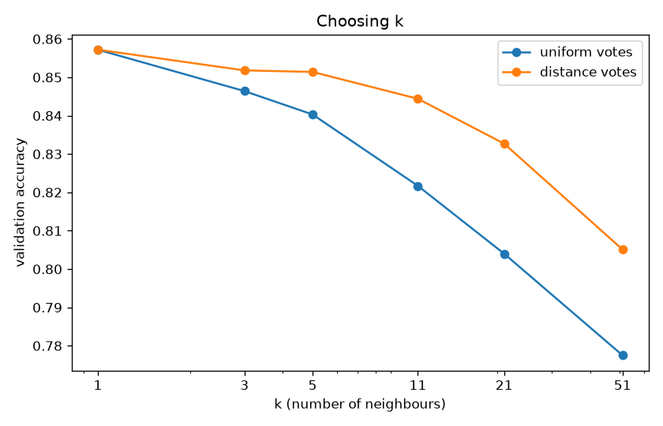
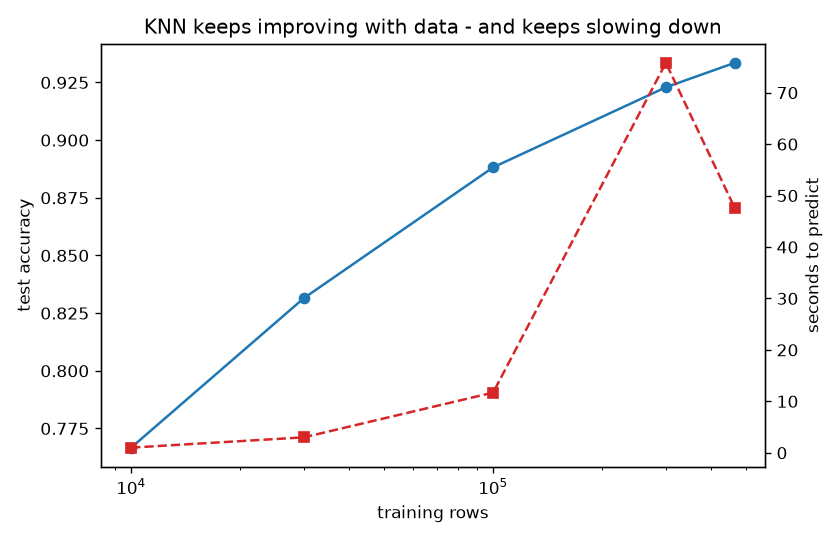
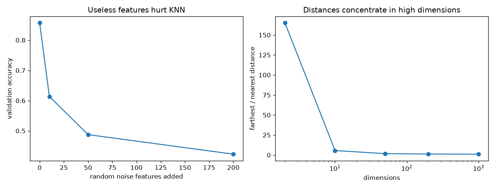

# Project 4 - K-Nearest Neighbours: Which Tree Grows Here?

**Course section:** 33 (K-Nearest Neighbours)
**Dataset:** [Forest Covertype](https://archive.ics.uci.edu/dataset/31/covertype) (US Forest Service / UCI):
581,012 patches of 30 × 30 m in Colorado's Roosevelt National Forest. Each has 10 measurements (elevation,
slope, distances to water, roads and past fires, sunlight) and 44 yes/no flags (4 wilderness areas, 40 soil
types). There are 7 tree types, from very common to rare: Lodgepole Pine 48.8%, Cottonwood/Willow 0.5%.
**The question:** can "you look like your neighbours" predict the forest, and what does it cost?

All the code is in [knn.py](knn.py), with a comment on every line. Tests: [test_knn.py](test_knn.py).

```powershell
cd "D:\AI Projects\ML_Mini_Projects\04_knn"
..\.venv\Scripts\python -m pytest -q        # 6 tests
..\.venv\Scripts\python knn.py              # full run, about 10 minutes (downloads via sklearn.datasets.fetch_covtype)
```

---

## The concepts, explained

### 1. The whole algorithm
To classify a new patch, find the **k training patches closest to it** and take a **majority vote**.
"Training" is just storing the data, so KNN is called a **lazy learner**: all the work happens at prediction
time.

### 2. Distance
Closeness is usually **Euclidean distance**, `sqrt(Σ (a_i − b_i)²)`, a straight line in feature space. The fast
way to compute it for thousands of pairs at once is `‖a‖² + ‖b‖² − 2·a·b`, where one matrix multiplication
does the heavy part (`pairwise_sq_dists`).

### 3. Choosing k
- **k = 1:** copy your single nearest neighbour. Very flexible, so it can be noisy.
- **Large k:** average over a big neighbourhood. Smooth, but rare classes get outvoted.

k is a hyperparameter chosen on **validation** data.

**Distance weighting** (`weights="distance"`) lets closer neighbours count more. This softens the damage from a
large k.

### 4. Scaling decides which features matter
Distance adds up differences across features, so **a feature measured in big numbers dominates**. Elevation
(about 2,000–3,800 m) swamps slope (0–66°). The textbook rule is "always standardise".

The deeper truth: **scaling is a choice of feature weights.** Standardising says every feature matters
equally. If one feature really is far more informative, equal weights make KNN *worse*, and that is exactly
what happened here (see the results).

### 5. The curse of dimensionality
In high dimensions, **every point is roughly the same distance from every other point**. Among random points,
the farthest is 165× farther than the nearest in 2-D, but only **1.12× in 1,000-D**. "Nearest" stops meaning
"similar". Every useless feature adds noise to every distance, so KNN needs **few, relevant features**.

### 6. The cost: slow predictions
Each prediction compares against stored training rows. Index structures help:
- a **KD-tree** splits space into boxes, which works well in low dimensions;
- a **ball tree** uses nested spheres.

Both stop helping as dimensions grow, and plain brute force (one big matrix multiplication) often wins.

### 7. Balanced accuracy
With 7 classes ranging from 49% down to 0.5%, plain accuracy is dominated by the two big pine/fir classes.
**Balanced accuracy** averages the accuracy *per class*, so rare trees count equally.

---

## Results (random 80/20 split: 464,809 training patches; 20,000 test patches scored)

### Scaling: the textbook rule failed, and that's the lesson
| Features (k = 1) | Test accuracy |
|---|---|
| **Raw units** | **96.5%** |
| Standardised | 93.4% |
| Standardised, elevation weighted ×4 | 94.6% |

Two things are going on:
1. **Elevation really is the master feature.** Tree species change with altitude. A decision tree gives
   elevation 50.5% of all importance, 5× more than the next feature. In raw metres elevation dominates the
   distance, which is accidentally the right weighting. Weighting elevation ×4 in the standardised version
   recovers a good part of the gap.
2. **Location leaks through the distances.** The other large raw features are horizontal distances to water,
   roads and fire points. Together they almost pinpoint *where* a patch is. With a random split, a test
   patch's nearest training neighbour is often the 30 m patch right next to it, which is nearly guaranteed to
   have the same trees. This **spatial autocorrelation** makes every random-split score on this dataset
   optimistic. A fair test would hold out whole regions, but the dataset doesn't include coordinates.

### Choosing k (standardised features, tuned on 50k rows, validated on 10k)
| k | 1 | 3 | 5 | 11 | 21 | 51 |
|---|---|---|---|---|---|---|
| uniform votes | **85.7%** | 84.6% | 84.0% | 82.2% | 80.4% | 77.8% |
| distance-weighted | **85.7%** | 85.2% | 85.1% | 84.4% | 83.3% | 80.5% |

k = 1 wins, which matches the "neighbouring patch" explanation above. Distance weighting makes larger k hurt
much less.



### More data keeps helping, and keeps costing (standardised, k = 1)
| Training rows | Accuracy | Balanced accuracy | Seconds to predict 20k rows |
|---|---|---|---|
| 10,000 | 76.7% | 64.2% | 1.0 |
| 30,000 | 83.2% | 73.2% | 3.0 |
| 100,000 | 88.8% | 81.7% | 11.7 |
| 300,000 | 92.3% | 87.4% | 75.8 |
| 464,809 | **93.4%** | **89.0%** | 47.6 |



KNN is a model that is "made of data": more rows mean denser neighbourhoods and better answers, with no sign of
levelling off. The price is paid at prediction time. (The timing at 300k is noisy because it shared the machine
with another job.)

### Search algorithms (100k training rows, 2,000 queries)
| | brute force | KD-tree | ball tree |
|---|---|---|---|
| 10 numeric features | 0.58 s | **0.43 s** | 6.2 s |
| all 54 features | **0.64 s** | 2.58 s | 37.6 s |

With 10 dimensions the KD-tree wins; with 54 it's 4× slower than brute force. That's the curse of
dimensionality in running time.

### The curse of dimensionality, measured
| Random noise features added | 0 | 10 | 50 | 200 |
|---|---|---|---|---|
| Validation accuracy | **85.7%** | 61.4% | 48.8% | 42.3% |

Ten useless columns cost 24 points: every junk feature adds random noise to every distance.



The from-scratch KNN (vectorised distances, `argpartition`, majority vote with scikit-learn's tie rule) agrees
with scikit-learn on **100%** of validation rows.

## Interview questions this project prepares you for
1. Why is KNN called a lazy learner? Where does its cost show up?
2. Why does scaling matter for KNN? Can scaling make it *worse*? (Yes: see above.)
3. Explain the curse of dimensionality with a concrete number.
4. How do you choose k? What does distance weighting change?
5. Why might a random split overstate accuracy on spatial data?
