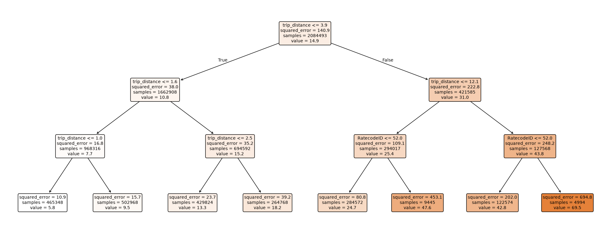
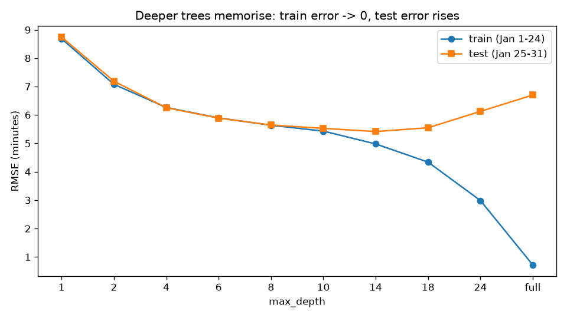
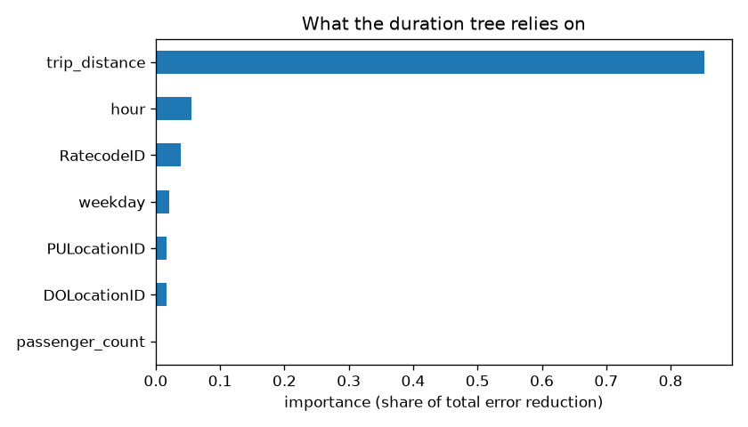

# Project 5 - Decision Trees: 2.96 Million NYC Taxi Trips

**Course section:** 34 (Decision Tree Classifier and Regressor)
**Dataset:** [NYC TLC Yellow Taxi trip records](https://www.nyc.gov/site/tlc/about/tlc-trip-record-data.page),
January 2024: 2,964,624 real trips with pickup and drop-off times, zones, distance, fare, payment type and tip.
It's public data from the NYC Taxi & Limousine Commission.
**Two questions:**
- **Regression:** how long will this trip take? (What a ride app's arrival estimate does.)
- **Classification:** will a card-paying passenger leave a tip?

All the code is in [decision_trees.py](decision_trees.py), with a comment on every line. Tests:
[test_decision_trees.py](test_decision_trees.py).

```powershell
cd "D:\AI Projects\ML_Mini_Projects\05_decision_trees"
curl.exe -o ..\_datasets\nyc_taxi\yellow_tripdata_2024-01.parquet https://d37ci6vzurychx.cloudfront.net/trip-data/yellow_tripdata_2024-01.parquet
..\.venv\Scripts\python -m pytest -q          # 5 tests
..\.venv\Scripts\python decision_trees.py     # full run, about 5 minutes
```

---

## The concepts, explained

### 1. A tree is a sequence of yes/no questions
"Is the distance ≤ 2.4 miles? → Is it rush hour? → …". Each answer leads further down the tree, and every
**leaf** gives a prediction: the **average** of its training trips for regression, or the **majority class**
for classification. You can read and explain the rules, which no other model in this series offers to the same
degree.



### 2. How a split is chosen (CART)
At every node the algorithm tries **every feature and every threshold**, and keeps the split that most reduces
the error:
- **regression:** the sum of squared errors, i.e. the variance of the trip durations;
- **classification:** **Gini impurity**, `1 − Σ p_k²` (0 means a pure node), or **entropy**.

It's **greedy**: the best split *now*, with no look-ahead. The from-scratch `best_split` uses running sums, so
each candidate threshold costs O(1), and it puts the threshold halfway between neighbouring values, like
scikit-learn. Its trees match scikit-learn's **exactly** (test).

### 3. Overfitting, and how to stop it
An unrestricted tree keeps splitting until every leaf holds one trip, which is **perfect memorisation**. The
brakes:
- `max_depth`: at most this many questions;
- `min_samples_leaf`: every leaf must average at least this many trips;
- **cost-complexity pruning** (`ccp_alpha`): grow fully, then cut back branches that don't earn their
  complexity.

This is the **bias–variance trade-off**:
- a shallow tree is too simple (**high bias**: wrong in the same way on every dataset);
- a deep tree chases noise (**high variance**: changes a lot with a different sample).

### 4. What trees do *not* need
- **No scaling:** a split only asks "≤ threshold?", so units don't matter. Compare KNN and SVM.
- **Non-linearity and interactions come free:** "distance matters more at rush hour" is just a deeper split.
- **The catch:** zone IDs (1–265) are arbitrary codes, but the tree treats them as ordered numbers and needs
  many splits to isolate particular zones. Target encoding or one-hot encoding are the usual fixes.

### 5. Feature importance
This is each feature's share of the total error reduction across all splits. It's handy, but it favours
features with many distinct values, so treat it as a hint rather than a proof.

### 6. Cleaning real data, with an audit trail
Raw TLC data contains negative fares (refunds and corrections), a 312,722-mile "trip", pickups dated 2002, and
taxis at 300 mph. Every rule records how many rows it removed, so nothing disappears silently.

### 7. A label you can't see: how a data-recording artifact fakes a model
Tips paid in **cash are never recorded**: they show as $0. A model that is given `payment_type` "learns" that
cash passengers never tip. Its score is excellent, and it's useless, because it has learned how the meter
records data, not how people behave.

---

## Results

**Cleaning:** 2,964,624 → **2,742,135** trips.

| Rule | Rows removed |
|---|---|
| missing passenger count / rate code | 113,548 |
| distance not 0.1–100 miles | 38,590 |
| duration not 1–180 minutes | 37,104 |
| fare not $3–$500 | 33,143 |
| faster than 80 mph | 86 |
| pickup outside January 2024 | 18 |

**Split by time:** train on Jan 1–24 (2,084,493 trips), test on Jan 25–31 (657,642 trips).

### Trip duration (regression)
| Model | Test RMSE (minutes) | Test MAE (minutes) |
|---|---|---|
| Always predict the average | 11.85 | 8.18 |
| Linear regression | 6.95 | 4.75 |
| Decision tree, depth 14 | 5.42 | 3.22 |
| Decision tree, `min_samples_leaf=50` | **5.10** | |

### Watching a tree overfit
| max_depth | Leaves | Train RMSE | Test RMSE |
|---|---|---|---|
| 1 | 2 | 8.69 | 8.74 |
| 4 | 16 | 6.27 | 6.26 |
| 8 | 252 | 5.64 | 5.65 |
| **14** | **10,608** | 4.98 | **5.42** |
| 18 | 85,013 | 4.34 | 5.55 |
| 24 | 674,350 | 2.99 | 6.13 |
| unlimited | 1,950,207 | **0.72** | **6.70** |



`min_samples_leaf` (unlimited depth): 1 → 6.70, **50 → 5.10**, 1,000 → 5.43, 5,000 → 5.72.

### Will they tip? (classification)
| Setup | Test AUC | Most important feature |
|---|---|---|
| All trips, with `payment_type` | **0.940** | `payment_type` |
| Card trips only (honest) | **0.710** | `fare_amount` |

### What the results show
1. **Trees beat a straight line by 27%** (RMSE 5.10 vs 6.95). Trip time isn't linear in distance: traffic,
   zones and hour interact, and trees capture that for free.
2. **The textbook bias–variance curve, on real data.** Shallow trees underfit, since train and test errors are
   both high and close together. Past depth 14, training error keeps falling while test error rises. The
   unlimited tree has 1.95 million leaves for 2.08 million trips: it memorised the training set (0.72 min error
   on training trips, 6.70 on new ones).
3. **`min_samples_leaf` beat `max_depth`.** It lets busy parts of the city split finely while quiet parts
   stay coarse, instead of applying one depth everywhere.
4. **AUC 0.94 → 0.71 when the recording artifact is removed.** Cash trips record $0 tips, so `payment_type`
   "predicts" tipping perfectly. Among card payers, 95.5% tip, and the honest question is a hard one.
5. **A caveat about method:** the depth and leaf size were picked by looking at the test week. Strictly, they
   should be picked on a separate validation week, as in Project 1's step 7. The differences between the top
   candidates are small, so the conclusions hold.
6. **What a single tree can't fix:** its predictions are step-shaped, and it's unstable. Train on a slightly
   different month and the top splits can change. **Random forests and boosting (Projects 6–9)** fix exactly
   this by combining hundreds of trees.



## Interview questions this project prepares you for
1. How does a decision tree choose a split? Gini vs entropy vs variance reduction?
2. Why do decision trees overfit, and what are three ways to stop it?
3. Why don't trees need feature scaling?
4. Your tip model has AUC 0.94. What would you check? (What does `payment_type` do to the label?)
5. Why is a single tree unstable, and how do ensembles fix it?
