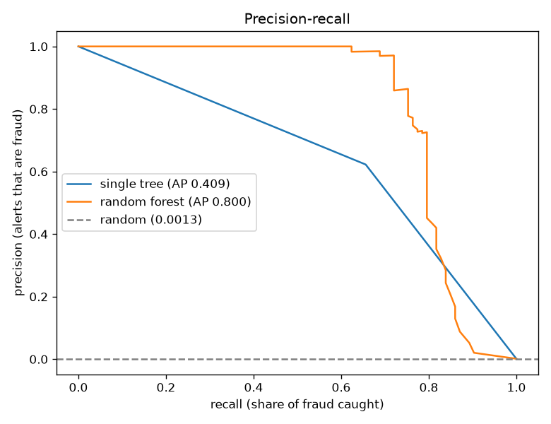
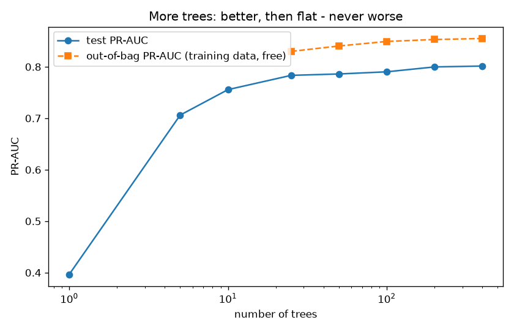

# Project 6 - Random Forest: Catching Card Fraud

**Course section:** 35 (Random Forest)
**Dataset:** [Credit Card Fraud Detection](https://www.kaggle.com/datasets/mlg-ulb/creditcardfraud) (Worldline
and the ULB Machine Learning Group): 284,807 real European card transactions over two days in September 2013,
of which **492 are fraud (0.17%)**. For privacy the bank released 28 anonymised features (V1–V28, from PCA)
plus the amount and the time. Licence: ODbL. The sample in `data/` keeps all frauds and 9,000 normal
transactions.
**The question:** with a small team that can review only 0.1% of transactions, how much fraud can a forest
catch?

All the code is in [random_forest.py](random_forest.py), with a comment on every line. Tests:
[test_random_forest.py](test_random_forest.py).

```powershell
cd "D:\AI Projects\ML_Mini_Projects\06_random_forest"
..\.venv\Scripts\python -m pytest -q          # 5 tests
..\.venv\Scripts\python random_forest.py      # full run (about 15 min on 12 cores)
```

---

## The concepts, explained

### 1. Why one tree isn't enough
A deep decision tree has **low bias** (it can fit anything) but **high variance**: train it on slightly
different data and you get a very different tree (Project 5).

**Averaging many different trees cancels out their individual mistakes,** the same way a crowd's average
guess beats most individuals.

### 2. Bagging (bootstrap aggregating)
Train each tree on a **bootstrap sample**: draw n rows *with replacement* from the n training rows. About 63%
of rows end up in each sample (some twice), and about 37% are left out. Each tree sees a different version of
the data, so they disagree in useful ways. Predict by averaging the trees' probabilities.

### 3. The "random" in random forest
If one feature is very strong (V14 here), every bagged tree splits on it first, so the trees all look alike
and averaging helps less. A random forest also lets each split consider only a **random subset of features**
(`max_features`, by default √29 ≈ 5). That **decorrelates** the trees, and averaging decorrelated trees
reduces variance much more.

### 4. Out-of-bag (OOB) evaluation: a free validation set
Every row was left out of about 37% of the trees. Average only *those* trees' predictions for that row and you
get an honest estimate on the training data, with no hold-out set needed (`oob_proba`).

### 5. More trees never overfit
Adding trees only makes the average *more stable*; it doesn't add flexibility. The score rises and then
flattens. The only cost is time. (What *can* overfit is each tree's depth, i.e. `min_samples_leaf`.)

### 6. Metrics for a 0.17% problem
- **Accuracy is useless:** "never fraud" scores 99.87%.
- **ROC-AUC is too kind:** it counts the huge number of easy legitimate transactions.
- **PR-AUC (average precision)** asks: when I flag transactions, how many are really fraud? For random
  guessing it equals the fraud rate (0.0013).
- **Business view:** a team reviews the **top 0.1%** most suspicious transactions. How many alerts are real
  (precision), what share of fraud is caught (recall), and what share of **fraud euros** is caught?

### 7. Class weights
`class_weight="balanced"` makes each fraud count about 560× more in the split criterion. In a forest this
changes which splits are chosen, not just the probabilities, so it can help or hurt. Measure it.

### 8. Feature importance: two kinds
- **Impurity (MDI)**, the built-in `feature_importances_`: how much each feature reduced impurity during
  training. It's free, but computed on *training* data, and it's known to favour features with many distinct
  values.
- **Permutation importance:** shuffle one column of the *test* data and measure how much the score drops. It's
  slower, but it measures what the model actually uses on new data.

---

## Results (split by time: first 36 hours to train, last 12 hours to test; 1,081 duplicates removed)

Train: 212,795 transactions (380 fraud). Test: 70,931 transactions (93 fraud). A model that always says
"legitimate" scores 99.87% accuracy and catches nothing.

### One tree → bagging → random forest (300 trees)
| Model | ROC-AUC | PR-AUC | Precision in top 0.1% | Fraud caught (count) | **Fraud € caught** |
|---|---|---|---|---|---|
| Single deep tree | 0.828 | 0.409 | 64.3% | 48.4% | 31.1% |
| Bagging (bootstrap rows) | 0.933 | 0.754 | 94.3% | 71.0% | 69.9% |
| **Random forest** (+ random features) | **0.948** | **0.800** | **95.7%** | **72.0%** | **72.2%** |
| Random forest, from scratch (100 trees) | 0.928 | 0.786 | 95.7% | 72.0% | 72.2% |

Reviewing just 70 transactions (0.1%), the forest's alerts are **96% real fraud** and catch **72% of the
stolen money**.



### Number of trees
| Trees | 1 | 5 | 10 | 25 | 50 | 100 | 200 | 400 |
|---|---|---|---|---|---|---|---|---|
| Test PR-AUC | 0.397 | 0.706 | 0.756 | 0.783 | 0.786 | 0.790 | 0.800 | **0.802** |
| OOB PR-AUC | | | | 0.830 | 0.841 | 0.849 | 0.853 | 0.855 |



### `max_features` (features considered per split; 200 trees)
| 1 | 3 | **√29 ≈ 5** | 10 | 50% | all 29 (= bagging) |
|---|---|---|---|---|---|
| 0.787 | 0.794 | **0.800** | 0.794 | 0.796 | 0.749 |

### Class weights (300 trees)
| Setting | ROC-AUC | PR-AUC | Precision top 0.1% | Fraud € caught |
|---|---|---|---|---|
| none | 0.948 | 0.800 | 95.7% | **72.2%** |
| balanced | **0.972** | 0.813 | 94.3% | 63.3% |
| balanced_subsample | 0.971 | **0.820** | **97.1%** | 63.4% |

### What the results show
1. **Averaging is the whole trick.** PR-AUC went from 0.41 for one tree to 0.80 for 300, and money caught
   went from 31% to 72%. Half of that gain comes from 5 trees.
2. **Random feature subsets beat plain bagging** (0.800 vs 0.754 PR-AUC), and `max_features = all` *is*
   bagging (0.749). Decorrelating the trees is what makes the forest. Too few features per split (1) hurts a
   little too.
3. **More trees never hurt.** The curve flattens after about 200; 400 is just slower.
4. **OOB is a free but optimistic estimate here** (0.855 OOB vs 0.802 test). The test week is *later* in time,
   and fraud patterns drift. OOB can't see that drift, because it samples from the same period.
5. **Class weights: better metrics, less money.** Balanced weights raised ROC-AUC (0.948 → 0.972) and PR-AUC,
   yet the top-0.1% alerts caught *fewer euros* (72% → 63%). The weighted model ranks more small frauds
   highly. Choose the metric that matches the business goal: here, money recovered.
6. **The importance trap didn't spring this time, and that's the honest result.** The planted noise column got
   an impurity importance of 0.0077 (0.77%) against about 0.0001 from permutation, so MDI did credit pure noise
   with something. But it still ranked 29th of 30. MDI's bias is towards features with *many more distinct
   values* than the others, and here every feature is continuous, so the noise column had no advantage. (On
   the small sample, the test shows MDI ranking noise higher than permutation does.) Both methods agree that
   **V14, V17, V12 and V10** carry the signal.

## Interview questions this project prepares you for
1. Why does averaging many trees reduce variance? Why does randomising features help further?
2. What is out-of-bag error, and when can it mislead?
3. Can a random forest overfit by adding trees?
4. Why is accuracy useless for fraud? What do you report instead?
5. Impurity vs permutation importance: which do you trust, and why?
