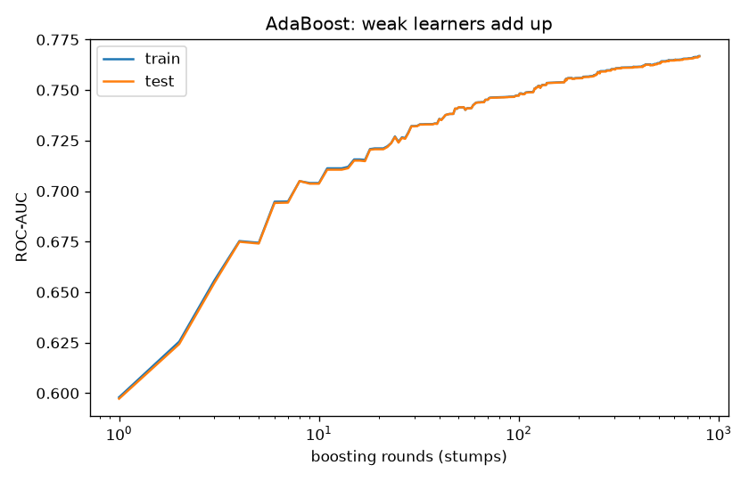
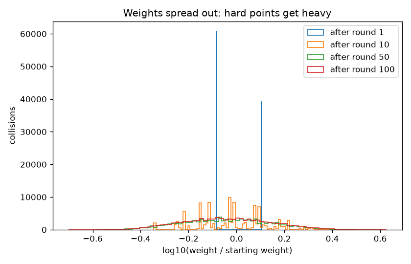

# Project 7 - AdaBoost: Finding the Higgs Boson in 11 Million Collisions

**Course section:** 36 (AdaBoost)
**Dataset:** [HIGGS](https://archive.ics.uci.edu/dataset/280/higgs) (UCI; Baldi, Sadowski & Whiteson,
*Nature Communications* 2014). 11 million simulated proton collisions, each either a Higgs-boson **signal**
process or a look-alike **background** process. Each event has 21 raw detector measurements (momenta and
angles of a lepton and four jets) plus 7 **masses that physicists derive** from those raw values. The last
500,000 events are the official test set. Licence: CC BY 4.0.
**The question:** can many very weak learners add up to a strong one, and do hand-engineered physics features
still matter?

All the code is in [adaboost.py](adaboost.py), with a comment on every line. Tests:
[test_adaboost.py](test_adaboost.py).

```powershell
cd "D:\AI Projects\ML_Mini_Projects\07_adaboost"
..\.venv\Scripts\python -m pytest -q      # 4 tests
..\.venv\Scripts\python adaboost.py       # full run (500k train / 500k official test), about 45 min of compute
```
The data is 2.8 GB from UCI (`higgs.zip`, containing `HIGGS.csv.gz`). `data/` holds a 20,000-event sample.

---

## The concepts, explained

### 1. Weak learners
A **decision stump** is a tree with one question ("is m_bb > 1.06?"). On its own it's barely better than a
coin flip: here AUC 0.597, accuracy 61% where 53% is the majority class. **Boosting's claim:** add up enough
of them, each fixing the previous ones' mistakes, and you get a strong model.

### 2. How AdaBoost works, round by round
1. Give every training point the same weight.
2. Fit a stump on the **weighted** data.
3. Compute its weighted error `err`.
4. Give it a vote `α = learning_rate · log((1 − err)/err)`. Accurate stumps get a big say; a coin flip gets 0.
5. **Increase the weight of every point it got wrong,** multiplying by `e^α`, then renormalise.
6. Repeat. The final prediction is the sign of `Σ α_t · h_t(x)`.

A neat fact (tested): right after reweighting, the misclassified points hold **exactly half** of the total
weight. So the next stump is forced to pay attention to them.

### 3. Why "adaptive"?
Each new learner adapts to the current mistakes. That's the key difference from bagging and random forests,
where trees are independent and trained in parallel. **Boosting is sequential:** tree t depends on trees
1…t−1. That's why it can't use many CPU cores, and why this project's full run is slow.

### 4. What AdaBoost is minimising
AdaBoost is gradient descent on the **exponential loss**, `e^(−y·F(x))`. A point that is badly wrong gets an
*exponentially* large penalty. That's powerful, but it's also why AdaBoost is said to be sensitive to
**mislabelled points and outliers**: it keeps trying to fix them. Project 8's gradient boosting generalises the
idea to any loss.

### 5. The knobs
- `n_estimators`: the number of rounds.
- `learning_rate`: shrinks every vote. Smaller steps need more rounds but usually generalise better.
- **Weak-learner depth:** stumps can only add up one-feature effects. Depth-2 trees can capture
  **interactions** between pairs of features.

### 6. Feature engineering vs raw data
The 7 "high-level" features are invariant masses that physicists compute from the raw momenta using their
knowledge of particle decays. The famous 2014 paper showed that *shallow* models need them, while *deep*
neural networks can learn equivalent features from the raw data alone.

---

## Results (train: first 500,000 events; test: the official last 500,000)

### From one stump to 800
| Rounds (stumps, lr 0.5) | 1 | 10 | 50 | 100 | 200 | 400 | 800 |
|---|---|---|---|---|---|---|---|
| Train AUC | 0.598 | 0.704 | 0.741 | 0.747 | 0.756 | 0.762 | 0.767 |
| **Test AUC** | 0.597 | 0.704 | 0.742 | 0.747 | 0.756 | 0.761 | **0.767** |



### Weak-learner depth × learning rate (300 rounds; fit on 100k events)
| | lr 0.1 | lr 0.5 | lr 1.0 |
|---|---|---|---|
| depth 1 (stumps) | 0.736 | 0.759 | 0.760 |
| depth 2 | 0.767 | 0.775 | **0.785** |
| depth 3 | 0.783 | 0.784 | 0.783 |

### Raw detector data vs physicists' features (depth 2, 300 rounds, 100k events)
| Features | Test AUC |
|---|---|
| 21 low-level (raw detector readings) | 0.620 |
| 7 high-level (engineered masses) | 0.757 |
| all 28 | **0.775** |

### Label noise: flip 10% of training labels (depth 2, 200 rounds, 100k events)
| | AdaBoost AUC | Random forest AUC |
|---|---|---|
| clean labels | 0.773 | **0.801** |
| 10% labels flipped | 0.774 | 0.799 |

AdaBoost's final share of weight on the flipped points: **14.1%** (10% if weights stayed even).

The from-scratch AdaBoost gives the **same α for every round** as scikit-learn and **identical** test
predictions.



### What the results show
1. **Weak learners do add up.** One stump scores 0.597. 10 stumps reach 0.704, and 800 reach 0.767. Each round
   adds a little, with diminishing returns.
2. **No overfitting with 500k rows.** Train and test AUC stay within 0.001 for all 800 rounds. Stumps are so
   simple, and the data so large, that AdaBoost has nothing to memorise. (On small data it does overfit
   eventually.)
3. **Interactions matter more than more rounds.** Moving from stumps to depth-2 trees (0.760 → 0.785) gained
   more than going from 400 to 800 stumps (+0.005). The physics lives in *combinations* of measurements.
4. **Feature engineering made the biggest difference of all: AUC 0.620 from raw readings vs 0.757 from 7
   physics-derived masses.** A shallow boosted model can't reconstruct an invariant mass from 21 momenta and
   angles; a physicist's formula can. This is exactly the gap that motivated deep learning on this dataset:
   deep networks learned those features themselves (the 2014 paper reports AUC of about 0.88 with deep nets).
5. **The famous noise sensitivity barely showed, and that's informative.** AdaBoost did shift attention to
   the flipped points (14.1% of the weight vs 10% if it stayed even), but its test AUC didn't drop. HIGGS is
   already intrinsically noisy: signal and background overlap heavily, so many *correctly* labelled points are
   "hard" too, and the weight was spread out before any labels were flipped. AdaBoost's noise problem is worst
   on *clean, separable* data with a few wrong labels, run for many rounds. The random forest was better
   overall (0.80 vs 0.77) and equally unbothered.

## Interview questions this project prepares you for
1. Walk through one round of AdaBoost. How are the weights and α updated?
2. Bagging vs boosting: what's the difference, and which can run in parallel?
3. What loss does AdaBoost minimise, and why does that make it sensitive to label noise?
4. Stumps vs deeper weak learners: what do deeper trees add?
5. When does feature engineering beat a more complex model?
