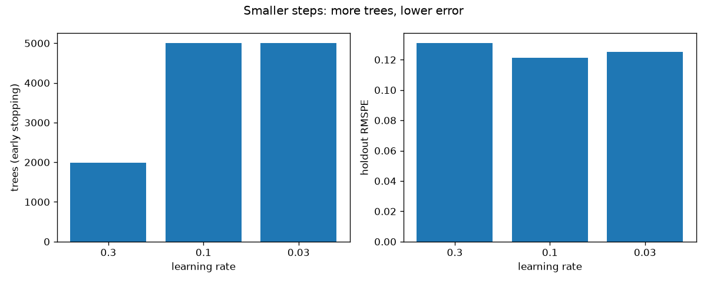
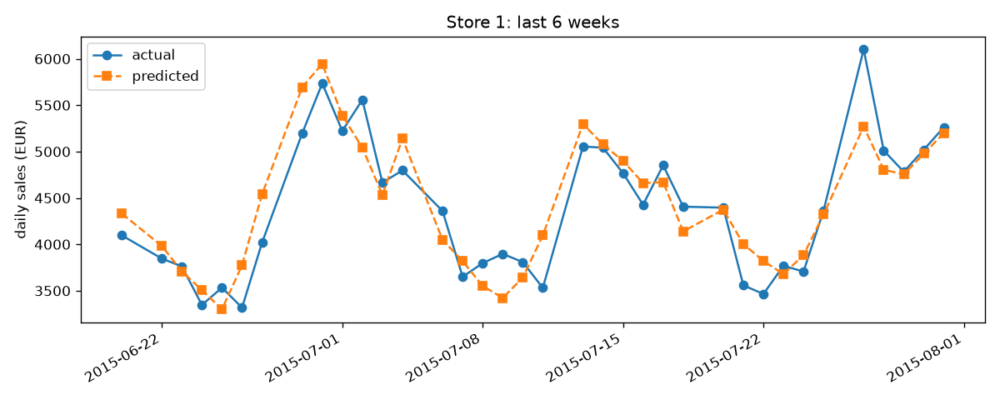

# Project 8 - Gradient Boosting: Forecasting Sales for 1,115 Rossmann Stores

**Course section:** 37 (Gradient Boosting)
**Dataset:** [Rossmann Store Sales](https://www.kaggle.com/competitions/rossmann-store-sales) (Kaggle
competition, 2015): 1,017,209 days of sales from 1,115 German drugstores, January 2013 to July 2015, with
promotions, holidays, store type, assortment and nearby competition. Competition data can't be redistributed,
so run [make_sample.py](make_sample.py) after downloading it. The sample is not in this repo.
**The question:** how well can we forecast each store's daily sales six weeks ahead?

All the code is in [gradient_boosting.py](gradient_boosting.py), with a comment on every line. Tests:
[test_gradient_boosting.py](test_gradient_boosting.py).

```powershell
cd "D:\AI Projects\ML_Mini_Projects\08_gradient_boosting"
..\.venv\Scripts\kaggle competitions download rossmann-store-sales -p ..\_datasets\rossmann   # accept the rules first
..\.venv\Scripts\python make_sample.py           # 30-store sample for the tests
..\.venv\Scripts\python -m pytest -q             # 5 tests
..\.venv\Scripts\python gradient_boosting.py     # full run, about 30 minutes
```

---

## The concepts, explained

### 1. Boosting by fitting the errors
1. Start with the simplest prediction: the average (here, of log sales).
2. Compute the **residuals**, truth minus prediction: what's still unexplained.
3. Fit a small tree to predict the residuals.
4. Add a *shrunken* copy of that tree to the model: `prediction += learning_rate × tree`.
5. Repeat hundreds or thousands of times.

Each tree corrects what the previous ones got wrong. This is the same intuition as AdaBoost (Project 7), but
done by fitting errors directly instead of reweighting points.

### 2. Why "gradient"?
For squared error, the residual is exactly the **negative gradient** of the loss with respect to the
prediction. So each tree is a step of **gradient descent, taken in function space**. Swap the loss (absolute
error, log loss, quantile) and you swap what the trees fit (the negative gradient of *that* loss). This is
what makes gradient boosting general; AdaBoost is the special case of exponential loss.

### 3. The learning rate (shrinkage) and early stopping
A small learning rate means many small, careful steps, which usually generalise better but need more trees.
**Early stopping** holds out 10% of the training data and stops adding trees once that score stops
improving, so the number of trees is chosen automatically.

### 4. Histogram boosting: why modern libraries are fast
Classic gradient boosting tries every distinct value of every feature as a split point. **Histogram boosting**
first buckets each feature into 255 bins, then only tries bin edges. It's far faster, with almost no loss of
accuracy. This is the core trick of LightGBM, XGBoost's `hist` mode, and scikit-learn's
`HistGradientBoosting`. It also handles **missing values natively**, which the classic version can't.

### 5. Target encoding (for 1,115 store IDs)
Store number is a category, not a quantity, but native categorical support caps out at 255 categories. The
alternative is **target encoding**: replace each store by its average log sales (overall, and per weekday),
computed **from training days only**. Computing it on all days would leak the holdout's sales into its own
features.

### 6. The metric: RMSPE
Kaggle scored **root mean squared percentage error**. Missing by €500 at a store selling €2,000 (25%) counts
the same as missing by €2,500 at a €10,000 store. That's why we model **log(sales)**: in log space, equal
percentage errors are equal distances.

### 7. Leakage: `Customers`
The data includes each day's customer count, and it predicts sales extremely well. But **you don't know
tomorrow's customer count today**, and Kaggle's test file doesn't contain it. Using it is leakage.

---

## Results (holdout: the last 6 weeks, 19 June – 31 July 2015, 40,282 store-days; train: 804,056 open store-days)

| Model | Holdout RMSPE |
|---|---|
| Each store's median day | 0.313 |
| Store × weekday × promo median (a strong no-ML baseline) | 0.145 |
| **Histogram gradient boosting** (lr 0.1, 5,000 trees, log target) | **0.121** |
| Same model, raw sales as target | 0.139 |
| *Same model + `Customers` (leakage)* | *0.067* |

### Classic vs histogram (same 20,000 rows, 200 trees, depth 6)
| | Training time | RMSPE |
|---|---|---|
| Classic `GradientBoostingRegressor` | 24.9 s | 0.142 |
| `HistGradientBoostingRegressor` | **2.8 s** | 0.143 |

**9× faster, same accuracy.** On all 804,000 rows the classic version would take hours.

### Learning rate (early stopping, up to 5,000 trees)
| Learning rate | Trees used | Seconds | RMSPE |
|---|---|---|---|
| 0.3 | 1,983 (stopped early) | 189 | 0.131 |
| **0.1** | 5,000 (cap reached) | 373 | **0.121** |
| 0.03 | 5,000 (cap reached) | 557 | 0.125 |





### What the results show
1. **A good naive baseline is hard to beat, and boosting still beats it by 16%** (0.145 → 0.121). For
   forecasting, always report a "same weekday, same promo" baseline. Many published models don't beat it.
2. **Histograms are why boosting scales:** 9× faster at identical accuracy, plus native handling of missing
   values. The classic version crashed on stores with no recorded competitor until gaps were filled with −1.
3. **Learning rate and number of trees are one knob.** At 0.3 the model stopped early at a worse score. At
   0.03 it hadn't finished learning within 5,000 trees (0.125), so it would need more trees and more time to
   overtake 0.1. A smaller rate only wins if you can afford the trees.
4. **Log target: 0.139 → 0.121.** Matching the training loss to the evaluation metric is free accuracy.
5. **`Customers` nearly halves the error (0.067), and it's useless.** It's only known after the day is over.
   The model would score brilliantly in testing and be impossible to use for a forecast.
6. **A random split did not inflate the score here (0.1256 vs 0.1249), and why that's informative.** In
   Projects 1, 5 and 10, random splits leak information from the future. Here the features are only the
   calendar and store averages, with no "sales last week" (lag) features. So a random day reveals little
   about its neighbours. Add lag features, as every serious forecaster does, and random splitting becomes
   badly optimistic. Time-based validation is still the rule.
7. **From scratch:** on synthetic data the hand-written booster matches scikit-learn **exactly** (test). On
   Rossmann the predictions differ by up to 0.047 in log space (about 5%) for some store-days. The data has
   many exactly tied split candidates (integer days and weeks), and the two implementations break ties
   between equally good splits differently. Same algorithm, different but equally valid trees.

For context: the winning Kaggle RMSPE was about 0.100 on a different (later) six-week period, using heavy
feature engineering (lags, rolling means, external weather and Google Trends data). The results aren't
directly comparable, but it shows how far feature work goes.

## Interview questions this project prepares you for
1. Explain gradient boosting as gradient descent in function space.
2. Learning rate vs number of trees: how do they interact? What does early stopping do?
3. Why are histogram-based GBMs (LightGBM, XGBoost-hist) so much faster?
4. What is target encoding, and how can it leak?
5. Why model log(sales) for a percentage-error metric?
