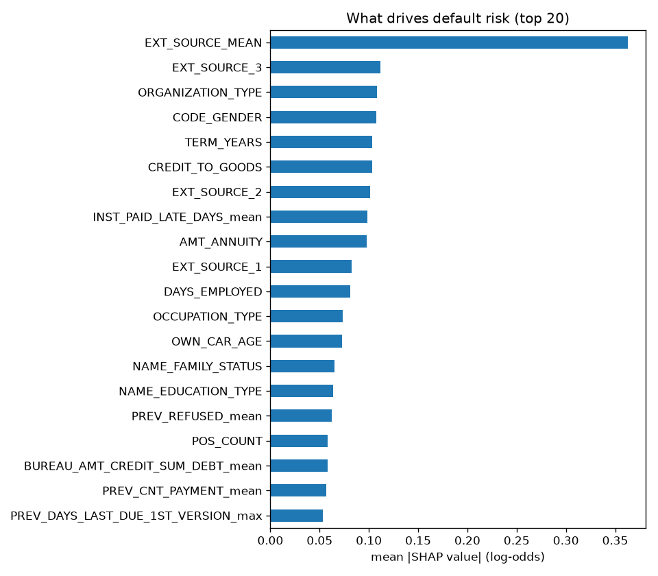
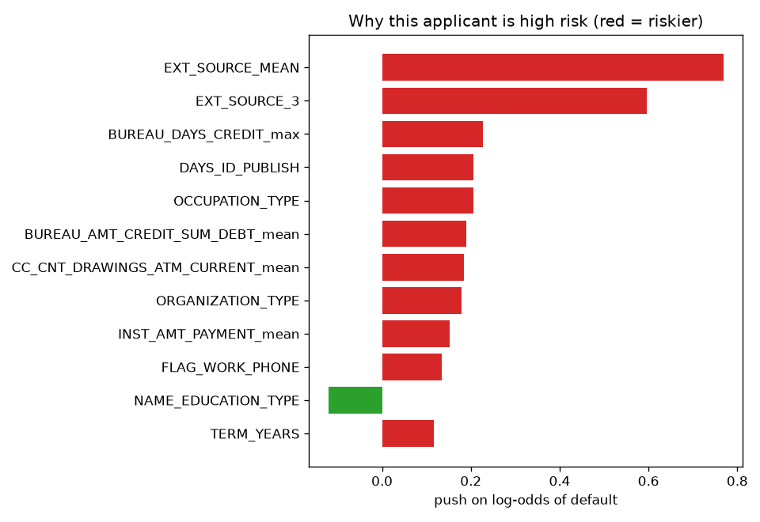

# Project 9 - XGBoost: Home Credit Default Risk (7 Linked Tables)

**Course section:** 38 (XGBoost)
**Dataset:** [Home Credit Default Risk](https://www.kaggle.com/competitions/home-credit-default-risk) (Kaggle
competition, 2018): 307,511 loan applicants from a lender serving people with little or no credit history.
**8.1% defaulted.** Around the application table sit six history tables with **58 million rows** in all:
- credit-bureau loans at other lenders, with their monthly status;
- previous Home Credit applications;
- instalment payments;
- point-of-sale loan balances;
- credit-card balances.

Competition data can't be redistributed, so run [make_sample.py](make_sample.py) after downloading. No data is
in this repo.
**The question:** how much does a lender gain by summarising an applicant's *whole history*, and what drives
the model's decisions?

All the code is in [xgboost_credit.py](xgboost_credit.py), with a comment on every line. Tests:
[test_xgboost_credit.py](test_xgboost_credit.py).

```powershell
cd "D:\AI Projects\ML_Mini_Projects\09_xgboost"
..\.venv\Scripts\kaggle competitions download home-credit-default-risk -p ..\_datasets\home_credit   # accept the rules first
..\.venv\Scripts\python make_sample.py         # 10,000-applicant sample of all 7 tables
..\.venv\Scripts\python -m pytest -q           # 5 tests
..\.venv\Scripts\python xgboost_credit.py      # full run, about 45 minutes
```

---

## The concepts, explained

### 1. What XGBoost adds to gradient boosting
XGBoost is gradient boosting (Project 8) with four upgrades:
- **Second-order steps:** it uses both the gradient *g* and the curvature (Hessian) *h* of the loss, like
  Newton's method. That gives better leaf values in fewer trees.
- **Regularisation built into the objective:** `λ` (L2 on leaf values), `α` (L1) and `γ` (a minimum gain to
  make a split).
- **Row and column subsampling** per tree (`subsample`, `colsample_bytree`), the random-forest trick borrowed
  for boosting.
- **Engineering:** histogram splits, multi-threading, native missing-value handling (each split learns
  whether missing values go left or right), and native categorical features.

### 2. The two formulas behind every tree
For a leaf containing rows with gradient sum **G** and Hessian sum **H**:
- **Best leaf value:** `w = −G / (H + λ)`
- **Gain of a split** into left/right: `½·[G_L²/(H_L+λ) + G_R²/(H_R+λ) − (G_L+G_R)²/(H_L+H_R+λ)] − γ`

For log loss, `g = p − y` and `h = p·(1 − p)`. A from-scratch booster using exactly these formulas
(`ScratchXGBStumps`) matches the real XGBoost library to within 0.00001 on test data, and 0.003 on Home Credit
columns.

### 3. Relational feature engineering
Models need **one row per applicant**, but history lives in many rows per applicant. The standard recipe:
**aggregate** each history table per applicant (mean, max and min of every numeric column, plus a count),
after adding a few meaningful columns first: "days paid late", "amount paid short", "was refused", "loan still
active". 122 application columns become **351 features**.

### 4. Data traps
- `DAYS_EMPLOYED = 365243` (that is, "employed for 1,000 years") appears for **55,374 applicants**. It's a
  placeholder code for pensioners and the unemployed. It's replaced by a missing value plus a 0/1 flag.
- Days are stored as negative numbers ("−12,000 days before applying"), so age is `−DAYS_BIRTH / 365.25`.

### 5. The knobs that matter
- `max_depth` and `min_child_weight` control tree size and overfitting.
- `eta` (learning rate) with **early stopping** on a validation set decides how many trees to use.
- `subsample` and `colsample_bytree` add randomness that decorrelates trees.
- `lambda` and `alpha` shrink leaf values.
- `scale_pos_weight` up-weights the rare class.

### 6. SHAP: explaining every decision
For each applicant, **TreeSHAP** (built into XGBoost via `pred_contribs=True`) splits the prediction into one
contribution per feature, and these add up exactly to the model's log-odds. Averaging |contribution| gives
global importance. In credit, explaining individual decisions isn't optional: lenders must be able to give
reasons for rejections.

---

## Results (stratified split: 70% train / 10% validation for early stopping / 20% test)

| Model | Features | Trees (early stopping) | Test ROC-AUC |
|---|---|---|---|
| Application table only | 127 | 493 | 0.770 |
| + credit-bureau history | 188 | 381 | 0.775 |
| **+ all 6 history tables** | **351** | 519 | **0.790** |

For reference, the winning Kaggle solutions reached about **0.80** (private leaderboard) with months of
feature work and ensembles of hundreds of models.

### One knob at a time (defaults: depth 6, min_child_weight 5, colsample 0.6, subsample 0.8, λ 1)
| Knob | Values → test AUC |
|---|---|
| `max_depth` | 3 → **0.791** · 6 → 0.790 · 9 → 0.787 |
| `min_child_weight` | 1 → 0.790 · 5 → 0.790 · 50 → **0.792** |
| `colsample_bytree` | 0.3 → **0.792** · 0.6 → 0.790 · 1.0 → 0.788 |
| `subsample` | 0.5 → 0.787 · 0.8 → **0.790** · 1.0 → 0.790 |
| `lambda` | 0 → 0.790 · 1 → 0.790 · 10 → 0.790 |

### Class imbalance
| | ROC-AUC | Brier score | Average predicted risk (true: 8.07%) |
|---|---|---|---|
| no weighting | **0.790** | **0.066** | **7.8%** |
| `scale_pos_weight = 11` | 0.787 | 0.160 | 35.4% |

### What drives the model (mean |SHAP|, log-odds)
| Rank | Feature | Meaning |
|---|---|---|
| 1 | EXT_SOURCE_MEAN | average of three external credit scores |
| 2 | EXT_SOURCE_3 | one external score |
| 3 | ORGANIZATION_TYPE | the applicant's employer type |
| **4** | **CODE_GENDER** | **the applicant's gender** |
| 5 | TERM_YEARS | credit ÷ annuity: years to repay |
| 6 | CREDIT_TO_GOODS | borrowing more than the item costs |
| 7–10 | EXT_SOURCE_2, INST_PAID_LATE_DAYS_mean, AMT_ANNUITY, EXT_SOURCE_1 | |





### What the results show
1. **History is worth more than tuning.** Adding the six history tables raised AUC by 0.020 (0.770 → 0.790).
   The best single knob added about 0.002. Payment behaviour ("how many days late, on average") is among the
   top features.
2. **Tuning barely matters around sensible defaults.** Every knob moved AUC by at most ±0.003. Shallower trees
   (depth 3) and fewer columns per tree (0.3) helped slightly, which says the signal is spread across many
   weak, partly redundant features. Deeper trees overfit sooner (only 181 trees before early stopping).
3. **`scale_pos_weight` hurts here.** AUC fell a little, and the probabilities became useless: an average of
   35% predicted risk against 8% reality. For pricing or provisioning, keep the unweighted model, and move the
   decision threshold instead. The same lesson as Projects 1 and 6.
4. **The model learned to use gender, and that is a real problem.** `CODE_GENDER` is the 4th most influential
   feature. It does carry statistical signal in this data, but gender is a **protected characteristic**: under
   the EU's anti-discrimination rules and the US Equal Credit Opportunity Act it can't be used to decide
   credit. A production model must remove it. Removing the column isn't enough, though: correlated features
   (occupation, organisation type) can act as **proxies**. The model's decisions then need checking for
   disparate impact across groups. Accuracy isn't the only requirement for a credit model.
5. **External scores dominate.** The three `EXT_SOURCE` scores (from other credit bureaus) are by far the
   strongest signals. That's why credit scoring is hard for people with no history, the very customers this
   lender serves.

## Interview questions this project prepares you for
1. What does XGBoost add to plain gradient boosting? Derive the leaf weight `−G/(H+λ)`.
2. How do you turn one-to-many tables into features for a tabular model?
3. Which XGBoost parameters control overfitting, and how does early stopping fit in?
4. What is SHAP, and why do lenders need per-decision explanations?
5. Your credit model relies on gender. What do you do, and why isn't dropping the column enough?
