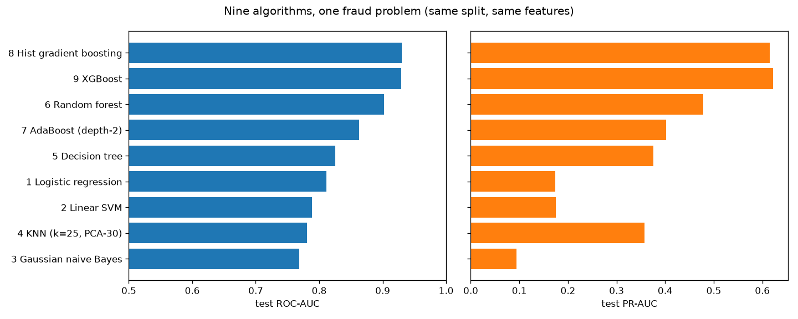

# Project 10 - Capstone: Nine Algorithms, One Fraud Problem

**Dataset:** [IEEE-CIS Fraud Detection](https://www.kaggle.com/competitions/ieee-fraud-detection) (Kaggle
competition, 2019, with Vesta Corporation): 590,540 real e-commerce card transactions over six months. **3.5%
are fraud.** There are 434 anonymised columns across two tables:
- **transactions:** amount, card, address, e-mail domains, counts (C1–C14), time deltas (D1–D15), matches
  (M1–M9), and 339 engineered "V" features;
- **identity:** device, browser and network information, available for about 24% of transactions.

Competition data can't be redistributed, so run [make_sample.py](make_sample.py) after downloading. No data is
in this repo.
**The question:** put every algorithm from Projects 1–9 on the same hard problem, with the same split, the
same features and the same metrics. Which wins, at what cost, and what matters more than the algorithm?

All the code is in [capstone.py](capstone.py), with a comment on every line. Tests:
[test_capstone.py](test_capstone.py).

```powershell
cd "D:\AI Projects\ML_Mini_Projects\10_capstone"
..\.venv\Scripts\kaggle competitions download ieee-fraud-detection -p ..\_datasets\ieee_fraud   # accept the rules first
..\.venv\Scripts\python make_sample.py      # 30,000-transaction sample for the tests
..\.venv\Scripts\python -m pytest -q        # 4 tests
..\.venv\Scripts\python capstone.py         # full run, about 70 minutes
```

---

## Set-up
- **Split by time:** the first 80% of the six months for training (472,432 transactions), the last 20% for
  testing (118,108). Kaggle's own test set was also later in time.
- **Same 438 features for everyone:** 431 original columns, with text turned into category codes, plus 7
  engineered ones (below).
- **Each algorithm gets the preprocessing it needs:** imputation and scaling for linear models, KNN and SVM;
  PCA to 30 dimensions for KNN; nothing for tree models, which handle missing values themselves.
- **Algorithms that can't scale get a subsample, and the table says so:** the linear SVM and AdaBoost train on
  100k transactions, KNN on 50k.
- **Metrics:** ROC-AUC (Kaggle's metric), and PR-AUC, which is the honest one at 3.5% fraud. Random guessing
  scores 0.035.

## The key insight: identify the *person*, not the transaction
Fraud is committed by people, and a person makes many transactions. The data has no customer ID, but it can be
reconstructed:
- `D1` = days since the card was first used.
- `transaction day − D1` = **the day the card started**, which is the same for every transaction by one card
  holder.
- `card1 + addr1 + card start day` ≈ **one client** (`uid`).

From the client ID come features such as "how many transactions does this client make", "their usual amount",
"is this amount unusual *for them*" and "how many e-mail domains do they use". This idea, reverse-engineered
from the anonymised columns, was the core of the winning Kaggle solution.

---

## Results

### All nine algorithms (same time split, same 438 features)
| # | Algorithm | Trained on | Fit time | **ROC-AUC** | **PR-AUC** |
|---|---|---|---|---|---|
| 9 | **XGBoost** | 472k | 249 s | **0.930** | **0.622** |
| 8 | Hist gradient boosting | 472k | 380 s | **0.930** | 0.615 |
| 6 | Random forest | 472k | 414 s | 0.902 | 0.479 |
| 7 | AdaBoost (depth-2) | 100k | 568 s | 0.863 | 0.402 |
| 5 | Decision tree | 472k | 183 s | 0.826 | 0.376 |
| 1 | Logistic regression | 472k | 119 s | 0.812 | 0.174 |
| 2 | Linear SVM | 100k | 89 s | 0.789 | 0.175 |
| 4 | KNN (k=25, PCA-30) | 50k | 5 s + 14 s to predict | 0.781 | 0.358 |
| 3 | Gaussian naive Bayes | 472k | 48 s | 0.769 | 0.095 |



### Feature engineering vs algorithm (XGBoost)
| Features | ROC-AUC | PR-AUC |
|---|---|---|
| 431 original columns | 0.917 | 0.595 |
| **+ 7 client (uid) features** | **0.930** | **0.622** |

### Validation design (XGBoost, same features)
| Test set | ROC-AUC |
|---|---|
| **Last 20% in time (honest)** | **0.930** |
| Random 20% | 0.975 |

### What the results show
1. **Boosted trees win on tabular data, again.** XGBoost and histogram gradient boosting tie at the top (AUC
   0.930, PR-AUC about 0.62). They're also among the fastest to train on the full data. This matches what
   industry and Kaggle have found for a decade: on large, messy, mixed-type tables, gradient-boosted trees are
   the default to beat.
2. **The ranking follows how each model handles messy tables.**
   - **Tree ensembles** cope with missing values, odd scales and interactions natively.
   - **Linear models** (logistic regression, SVM) can't represent interactions, and their PR-AUC (about 0.17)
     is barely 5× random.
   - **Naive Bayes's** independence assumption is badly broken by 400 correlated features (PR-AUC 0.095).
   - **KNN** is interesting: its ROC-AUC is low (0.78) but its PR-AUC (0.36) beats both linear models. It's
     good at spotting transactions that closely resemble known frauds, but poor at ranking the rest. And that
     was trained on only 50k rows.
3. **ROC-AUC flatters weak models; PR-AUC doesn't.** Logistic regression's ROC-AUC (0.81) sounds respectable,
   but its PR-AUC of 0.17 means most of its flagged transactions are false alarms. The gap between the best and
   worst model is 0.16 in ROC-AUC but **6.5× in PR-AUC**. For rare events, report PR-AUC.
4. **One good idea beat every algorithm swap.** The seven client-ID features lifted XGBoost's PR-AUC from 0.595
   to 0.622. That's a bigger gain than the difference between XGBoost and histogram gradient boosting, and it
   cost no extra training time. Understanding *what the data represents* (people, not rows) is the
   highest-leverage skill in applied ML.
5. **A random split would have lied by 0.045 AUC (0.975 vs 0.930).** With random splitting, the same
   fraudster's transactions land in both train and test. The model then recognises the person rather than
   generalising to new fraud. In production, every fraud ring the model meets is new, so only the time-based
   score is real. This is the same lesson as Projects 1, 5 and 8, at its most dramatic.
6. **Cost of scale is part of the answer.** The kernel SVM (Project 2) couldn't run on 472k rows at all.
   AdaBoost took the longest of any model despite using a fifth of the data, because boosting is sequential.
   KNN trains instantly but is slow to predict. The best models were also among the most practical.

---

## What the whole series adds up to
| Lesson | Where it showed up |
|---|---|
| A great score is a reason to look harder | Lending Club leakage (P1), the broken Enron CSV (P3), `payment_type` tips (P5), `Customers` (P8), random splits (P10) |
| Validate the way the model will be used: split by time | P1, P5, P8, P10 |
| For rare events, accuracy and ROC-AUC flatter; use PR-AUC and business metrics | P1, P6, P10 |
| Re-weighting classes ruins probabilities; move the threshold instead | P1, P6, P9 |
| Features and data understanding beat tuning | P1 (tuning +0.005), P7 (physics features), P9 (history +0.020), P10 (uid) |
| Simple, strong baselines first | P5 (linear), P8 (store-weekday median) |
| Accuracy isn't the only requirement | P9 (gender in credit decisions) |

## Interview questions this project prepares you for
1. On a large tabular dataset, which algorithm would you try first, and why?
2. Why can ROC-AUC look good when a model is useless in practice?
3. Your random-split validation says 0.975 and production says 0.93. What happened?
4. Describe a feature-engineering idea that beat model tuning in a project of yours.
5. How do you compare algorithms fairly when some can't train on all the data?
